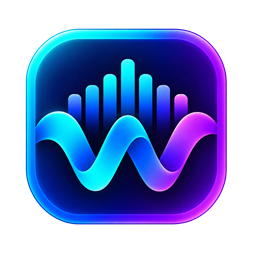

<div align="center">
  
  <h1>Wave Studio</h1>
  <p><strong>Seu áudio. Seu microfone. Seu estúdio.</strong></p>
  <p>Central universal de áudio para Windows, independente de fabricante.<br>Controle, personalização e mixagem para jogos, comunicação, streaming e música.</p>
  <p><code>v0.1.0 Alpha</code> · <code>Windows x64</code> · <code>C# / .NET 10</code> · <code>PT-BR</code></p>
  <p><a href="#recursos">Recursos</a> · <a href="#roadmap">Roadmap</a> · <a href="#experimentar">Experimentar</a> · <a href="#documentação">Documentação</a></p>
</div>

---

> [!IMPORTANT]
> **Alpha experimental.** Os controles do Windows e o teste de microfone já funcionam na prévia. Equalização global, monitoramento contínuo, microfone virtual e roteamento externo ainda estão em desenvolvimento. Não há instalador ou release pública.

## Recursos

### Disponíveis na prévia

- Seleção de entrada e saída, volume, mute e balanço estéreo quando suportado.
- Mixer de aplicativos do Windows e medidores reais de áudio.
- Teste de microfone de até 10 segundos, com reprodução explícita.
- EQ de 10 bandas, preamp, bypass, comparação A/B e perfis locais.
- Preferências persistentes, backup, restauração e detecção de dispositivos.

O EQ atual atua **somente sobre a gravação curta reproduzida dentro do Wave Studio**. Não modifica o áudio de jogos, Discord ou OBS. O áudio do teste permanece temporariamente em memória.

### Visão do produto

| Área | Funcionalidades planejadas |
| --- | --- |
| **Hub** | Equipamentos, catálogo visual e personalização |
| **Áudio** | EQ básico, 31 bandas e paramétrico, dinâmica, efeitos e surround 7.1 |
| **Microfone** | EQ, boost, redução de ruído, tratamento vocal, alteração de voz e Soundboard |
| **Mixer** | Mesa digital, faders, canais, barramentos, game/chat balance e gravação |
| **Reparos** | Diagnóstico e correções seguras de áudio e dispositivos |
| **Config** | Idiomas, temas, cores, wallpaper, animações, perfis e atalhos |

Também estão previstos integração com aplicativos externos, mix-minus e estudos de compatibilidade com VST3, Equalizer APO e AutoEQ. O acesso Apoiar será voluntário e não bloqueará recursos.

[Plano completo do produto](docs/PRODUCT_MASTER_PLAN.md)

## Estado atual

**18/11/2026 · Fase 2 — motor de áudio**

| Validação | Resultado |
| --- | --- |
| Testes automatizados | 737 em Debug e 737 em Release, conforme último relatório |
| Aceitação manual | 7 casos aprovados; aceitação integral pendente |
| WASAPI | Transporte silencioso implementado; prova física de 5 s ainda não aprovada |
| Próxima etapa | Prova silenciosa instrumentada (F2-I6B1-PROOF-4), após autorização |

A terceira prova física confirmou o transporte real de amostras e a liberação dos recursos, mas foi interrompida por divergência temporal do clock de captura. A validação temporal e a continuidade de pacotes foram exercitadas em replay e simulação. O monitoramento audível e a integração externa ainda dependem da prova física.

[Status detalhado](PROJECT_STATUS.md) · [Próxima tarefa](NEXT_TASK.md) · [Evidências WASAPI](docs/WASAPI_BACKEND_PLAN.md)

## Roadmap

| Fase | Objetivo |
| --- | --- |
| 0–1 | Arquitetura e controles básicos do Windows — base implementada |
| 2 | Motor de áudio, resampling, sincronização e monitoramento — em desenvolvimento |
| 3 | Integração real com aplicativos externos |
| 4–5 | Mesa digital, barramentos e roteamento |
| 6–7 | Equalização e tratamento de áudio/microfone |
| 8–10 | Soundboard, alteração de voz e surround |
| 11–12 | Gravação, perfis, automação, otimização e distribuição |

## Compatibilidade

**Windows 11 x64** é a plataforma prioritária (validação física pendente); **Windows 10 x64** é experimental. O projeto trabalha com os endpoints expostos pelo Windows: USB, Bluetooth, P2/P3, HDMI/DP, wireless e interfaces de áudio. Recursos de hardware dependem do suporte real de cada dispositivo.

Processamento local, sem envio de áudio pelo aplicativo. Sem driver próprio para os controles básicos.

## Experimentar

Na raiz do repositório, com o SDK definido em [global.json](global.json):

```powershell
dotnet run --project .\src\WaveStudio.Desktop -c Release
```

A prévia local anterior, se gerada, está em `artifacts/alpha-preview/win-x64/WaveStudio.exe` e requer .NET Desktop Runtime 10 x64. Não é um instalador público.

[Guia de teste e aceitação](docs/ALPHA_ACCEPTANCE.md) · [Teste de microfone e EQ](docs/EQ_PREVIEW.md)

## Desenvolvimento

**Stack:** C# · .NET 10 LTS · WinForms · NAudio · Core Audio/WASAPI · JSON · xUnit v3.

```powershell
dotnet restore WaveStudio.slnx --locked-mode -p:NuGetAudit=true -p:NuGetAuditMode=all
dotnet build WaveStudio.slnx -c Debug --no-restore
$env:TESTINGPLATFORM_TELEMETRY_OPTOUT = '1'
dotnet test --solution WaveStudio.slnx -c Debug --no-build
```

`src/` — aplicação e motor · `tests/` — testes · `assets/` — identidade visual · `docs/` — documentação

Os testes físicos Explicit são separados das regressões e exigem autorização específica. Comentários do código próprio em português brasileiro; internacionalização da UI planejada em Config → Idioma.

## Documentação

| Tema | Referências |
| --- | --- |
| Produto | [Plano mestre](docs/PRODUCT_MASTER_PLAN.md) · [Requisitos](docs/REQUIREMENTS.md) · [Hub](docs/PRODUCT_HUB_PLAN.md) |
| Engenharia | [Arquitetura](docs/ARCHITECTURE.md) · [Motor](docs/AUDIO_ENGINE_PLAN.md) · [WASAPI](docs/WASAPI_BACKEND_PLAN.md) · [Viabilidade](docs/FEASIBILITY.md) |
| Planejamento | [Implementação](docs/IMPLEMENTATION_PLAN.md) · [Efeitos futuros](docs/FUTURE_AUDIO_FEATURES.md) · [Próxima tarefa](NEXT_TASK.md) |
| Progresso | [Status](PROJECT_STATUS.md) · [Changelog](CHANGELOG.md) · [Revisões](REVIEW.md) |
| Qualidade | [Testes](docs/TEST_PLAN.md) · [Aceitação](docs/ALPHA_ACCEPTANCE.md) · [Auditoria](docs/GENERAL_CHECKUP.md) · [Recuperação](docs/RECOVERY_AUDIT.md) |
| Projeto | [Identidade visual](assets/branding/README.md) · [Licenças de terceiros](docs/THIRD_PARTY_NOTICES.md) · [Agentes](AGENTS.md) |

---

<div align="center">
  
  <p><strong>Wave Studio</strong><br>Controle real. Áudio personalizado.</p>
</div>
